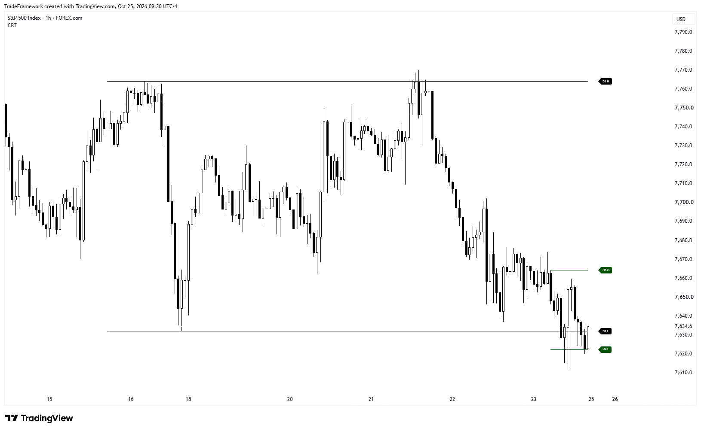
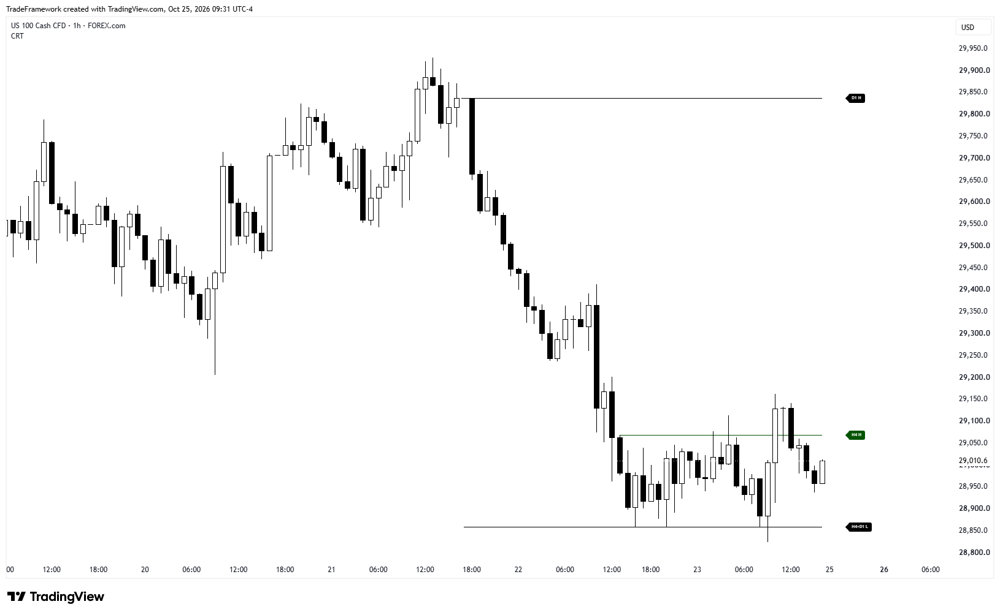
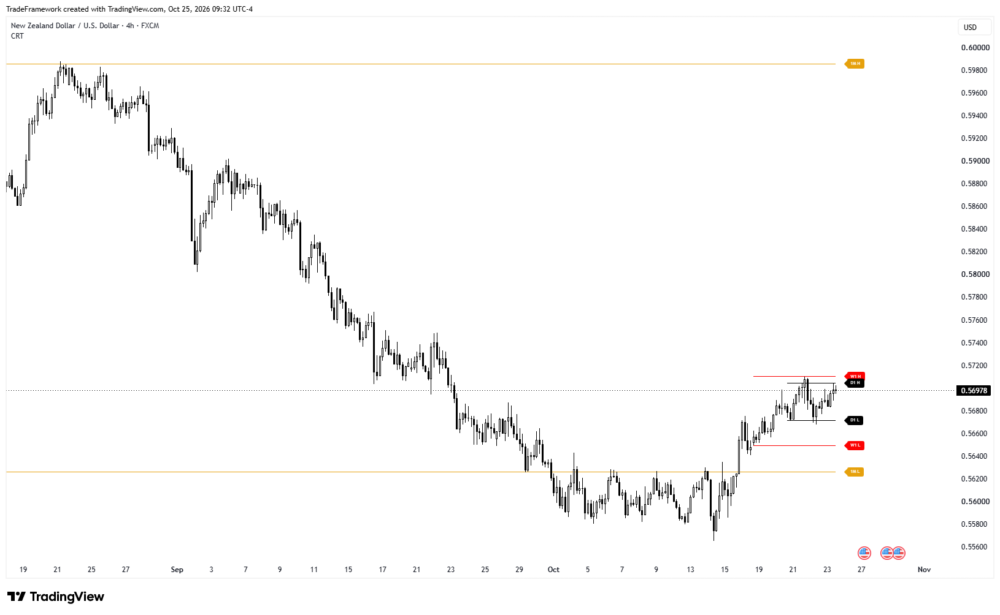

 

# CRT — Candle Range Theory

**A TradingView indicator inspired by Romeo's CRT approach**

Higher-timeframe candle range levels, configurable visuals, and alerts — developed by **Meta Program Labs**.

---

## 📸 Preview

  

### More examples

| Example 2 | Example 3 |
|:---:|:---:|
|  |  |

*Screenshots illustrate how the indicator draws levels and do not guarantee trading results.*

---

## 🔎 About the Indicator

**CRT (Candle Range Theory)** is a TradingView overlay indicator inspired by the CRT approach associated with Romeo.

The indicator plots the **high and low of a higher-timeframe candle** as a range on the chart and extends those levels to the right.

The range remains active while subsequent higher-timeframe candles stay within its boundaries. When a candle moves outside the range, or the range exceeds its configured lifetime, a new range is started.

Each level is labeled with its timeframe. For example, `D1 H` represents the daily high, while `D1 L` represents the daily low.

**This is an independent implementation by Meta Program Labs. It is not an official Romeo product and is not affiliated with or endorsed by Romeo.**

## ✨ Features

- **Nine timeframes:** H1, H4, H6, D1, W1, 1M, 3M, 6M, and 12M. Enable only the timeframes you need.
- **Independent timeframe settings:** Each timeframe has its own visibility toggle, color, line width, and line style.
- **One active range per timeframe:** When a new range forms, the previous range's lines are removed to keep the chart clean.
- **Timeframe labels:** Every level is labeled at the end of its line.
- **Automatic filtering:** Timeframes lower than the chart timeframe are hidden.
- **Alerts:** 18 alert conditions — bullish and bearish touch conditions for each timeframe.

## ⚙️ Settings

Each timeframe has a dedicated group in the indicator's settings menu.

| Setting | Description |
|---|---|
| **Show** | Enables or disables the timeframe |
| **Color** | Sets the color of lines and labels |
| **Width** | Sets line thickness from 1 to 4 |
| **Style** | Solid, dotted, or dashed |

### Default Settings

| Timeframe | Enabled by Default | Color |
|---|---|---|
| H1 | No | `#0400FF` |
| H4 | No | `#045302` |
| H6 | Yes | `#006D21` |
| D1 | Yes | `#000000` |
| W1 | Yes | `#FC0303` |
| 1M | No | `#E6A10D` |
| 3M | No | `#E60DD1` |
| 6M | No | `#0DD1E6` |
| 12M | No | `#D1E60D` |

## 🔔 Alerts

Two alert conditions are available for each timeframe:

- **Bullish Touch:** Price moves below the range low and the candle closes back above it.
- **Bearish Touch:** Price moves above the range high and the candle closes back below it.

To create an alert:

1. Open the alert dialog in TradingView.
2. Select this indicator.
3. Choose the required condition, such as `D Bullish Touch`.
4. Configure the alert and save it.

## 🚀 Installation

1. Open a chart on [TradingView](https://www.tradingview.com/).
2. Open the **Pine Editor** at the bottom of the screen.
3. Copy the contents of the `.pine` source file from this repository into the editor.
4. Click **Add to chart**.

## 📝 Notes

- The indicator can draw up to 500 lines and 500 labels.
- Levels are calculated using higher-timeframe data. Historical and real-time behavior may differ, so test the indicator on live bars before relying on it.
- This tool is designed for chart analysis. It does not predict future price movements and does not constitute financial advice.

## 📄 License

**© 2026 Meta Program Labs. All rights reserved.**

The source code is available for viewing and personal, non-commercial use on your own TradingView account. Copying, modifying, redistributing, republishing, or using the code commercially requires prior written permission.

See [LICENSE](LICENSE) for the full terms.

## 📬 Author & Links

**Meta Program Labs**

---

**META PROGRAM LABS**  
*Engineering Intelligence*

